# Звіт з лабораторної роботи № 3
**З дисципліни:** «Інформатика та програмування»  
**На тему:** «Розв'язання нелінійних рівнянь»  
**Виконав студент:** Лотоцький Назар  
**Група:** РС-зп61  
**Факультет:** РТФ  
**Університет:** КПІ ім. Ігоря Сікорського  

---

## 📋 Мета роботи
Розробка консольної програми мовою C для розв’язання нелінійних рівнянь чисельними ітераційними методами. Закріплення знань, умінь та навичок з технології розроблення програмного забезпечення з використанням мови програмування C, роботи з динамічною пам'яттю, валідації вхідних даних, виведення псевдографічних таблиць, табулювання функцій для визначення проміжків ізоляції коренів та вимірювання часу виконання алгоритмів.

---

## 🛠️ Загальна структура програми
Програма побудована за принципом послідовного інтерактивного покрокового виконання:
1. **Первинне дослідження та табулювання функції:**
   - Вибір режиму введення початкових даних (за кількістю точок $N$ або за кроком $\Delta x$).
   - Динамічне виділення пам'яті під масиви аргументів `x_arr`, значень `y_arr` та прапорців наявності проміжку ізоляції `is_gap`.
   - Табулювання досліджуваної функції $f(x)$ та автоматичне визначення проміжків ізоляції, на яких функція змінює знак ($y_i \cdot y_{i+1} < 0$).
   - Виведення значень у вигляді відформатованої псевдографічної таблиці.
2. **Вибір проміжку ізоляції та вибір чисельного методу:**
   - Автоматичний або ручний вибір знайденого проміжку $[\alpha, \beta]$.
   - Вибір ітераційного методу розв'язання: **Метод хорд** або **Метод половинного ділення (бісекції)**.
   - Введення параметрів точності: максимальної allowable похибки `max_err` ($>0$) та ліміту ітерацій `max_iter` (з можливістю продовження за запитом).
   - Вибір режиму детального виведення ходу ітерацій (`verbose`).
3. **Обчислення та вимірювання часу:**
   - Виконання чисельного пошуку кореня $x^*$, при якому $|f(x^*)| \le \text{max\_err}$.
   - Точне вимірювання часу обчислення за допомогою системного таймера `clock_gettime(CLOCK_MONOTONIC, ...)`.
   - Виведення підсумкових результатів, похибки та часу виконання (у секундах, мілісекундах, мікросекундах і наносекундах).

---

## 📌 Частина 1: Дослідження функції, аналіз похідних та проміжки ізоляції (Варіант 2)

### 1.1 Досліджувана функція та аналітичний розрахунок похідних

Визначено функцію за варіантом №2:

$$
f(x) = 0.25x^5 + 4(x + 20)^4 - 2x
$$

Обчислимо першу похідну функції $f'(x)$:

$$
f'(x) = \frac{d}{dx} \left( 0.25x^5 + 4(x + 20)^4 - 2x \right) = 1.25x^4 + 16(x + 20)^3 - 2
$$

Обчислимо другу похідну функції $f''(x)$:

$$
f''(x) = \frac{d^2}{dx^2} f(x) = \frac{d}{dx} \left( 1.25x^4 + 16(x + 20)^3 - 2 \right) = 5x^3 + 48(x + 20)^2
$$

### 1.2 Теоретичне підтвердження наявності та єдиності кореня

Для наявності єдиного розв'язку рівняння $f(x) = 0$ на проміжку ізоляції $[\alpha, \beta]$ мають виконуватися такі умови (теорема Больцано-Коші та достатні умови існування й єдиності кореня):

1. **Неперервність:** Функція $f(x)$ є неперервною на всьому проміжку $[\alpha, \beta]$.

2. **Зміна знака на межах:** $f(\alpha) \cdot f(\beta) < 0$.

3. **Монотонність (знакопостійність першої похідної):** $f'(x)$ зберігає знак на $[\alpha, \beta]$ ($f'(x) > 0$ або $f'(x) < 0$).

> **Висновок з аналізу похідних:**
>
> Значення $f'(x) > 0$ забезпечує строгу монотонність функції на досліджуваному відрізку, що ґарантує наявність **одного і лише одного** рішення на знайденому проміжку ізоляції.

### 1.3 Варіанти введення початкових даних:

1. **Варіант 1:** $X_1$, $X_2$, кількість точок $N \ge 2$. Крок розраховується як:
   

   $$
   \Delta x = \frac{X_2 - X_1}{N - 1}
   $$

2. **Варіант 2:** $X_1$, $X_2$, крок зміни аргументу $\Delta x > 0$. Кількість точок розраховується як:
   

   $$
   N = \left\lfloor\frac{X_2 - X_1}{\Delta x}\right\rfloor + 1
   $$
---

## 📌 Частина 2: Ітераційне розв'язання нелінійного рівняння

### Опис методів

#### 1. Метод хорд (Chord Method)
Метод ґрунтується на заміні кривої $y = f(x)$ хордою, що проходить через кінці відрізка. Залежно від знака добутку $f(x) \cdot f''(x)$, одна з точок відрізка $[\alpha, \beta]$ залишається нерухомою ($a$ або $b$), а інша послідовно уточнюється за формулою:
$$x_{k+1} = x_k - \frac{f(x_k)}{f(x_k) - f(a)} \cdot (x_k - a)$$

#### 2. Метод половинного ділення / Бісекції (Bisection Method)
Метод полягає у послідовному діленні проміжку $[\alpha, \beta]$ навпіл значенням $x = \frac{\alpha + \beta}{2}$. З двох утворених підінтервалів обирається той, на кінцях якого функція приймає значення протилежних знаків ($f(\alpha) \cdot f(x) < 0$).

---

## 💻 Специфікація вихідного коду (C)

У програмі реалізовано наступні основні функції та блоки:
- `f(double x)` — розрахунок значення досліджуваної функції $f(x)$.
- `printTable(double x_arr[], double y_arr[], unsigned int size)` — псевдографічний вивід таблиці аргументів та значень.
- `pressEnterToContinue()` — допоміжна функція паузи консолі.
- `clock_gettime(CLOCK_MONOTONIC, ...)` — точне вимірювання часу виконання обчислювального блоку.

---
### 📊 Блок-схема / Алгоритм
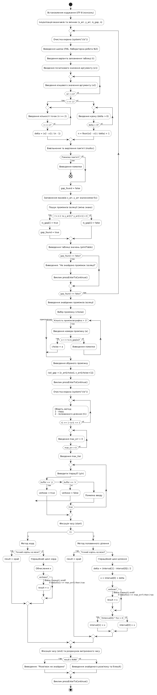
---
## 💻 Приклад виконання програми

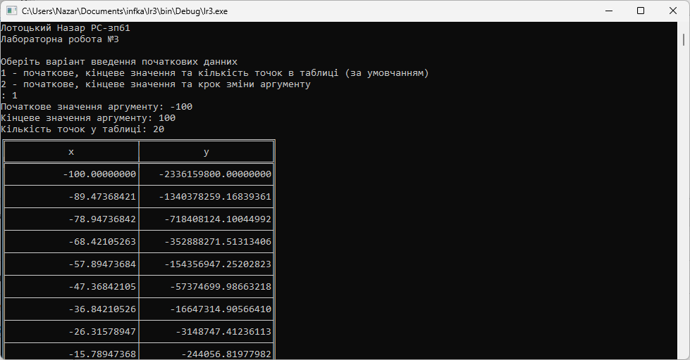
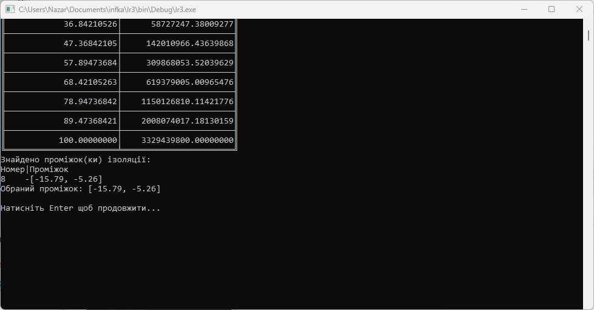
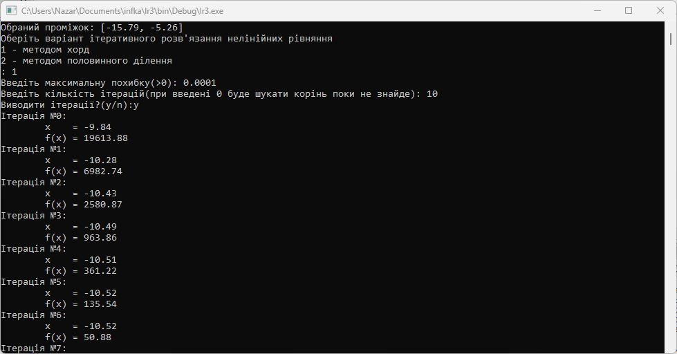
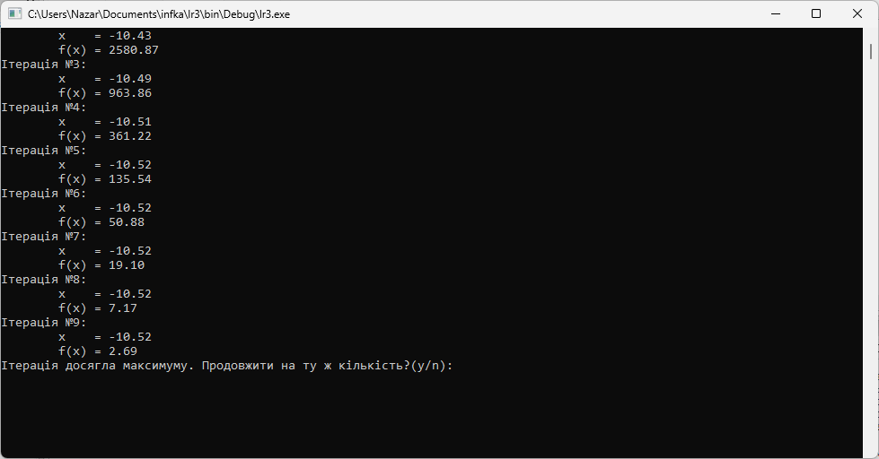
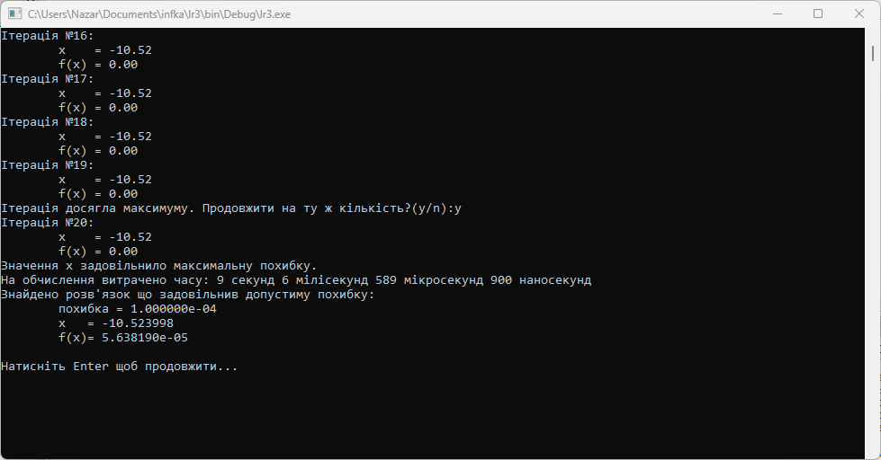
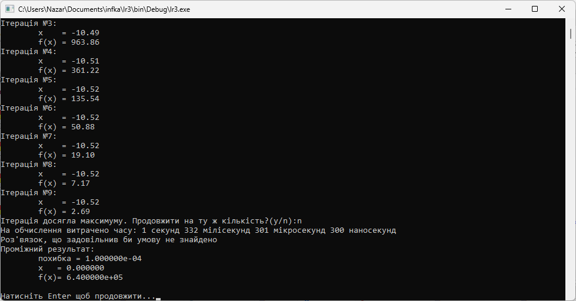
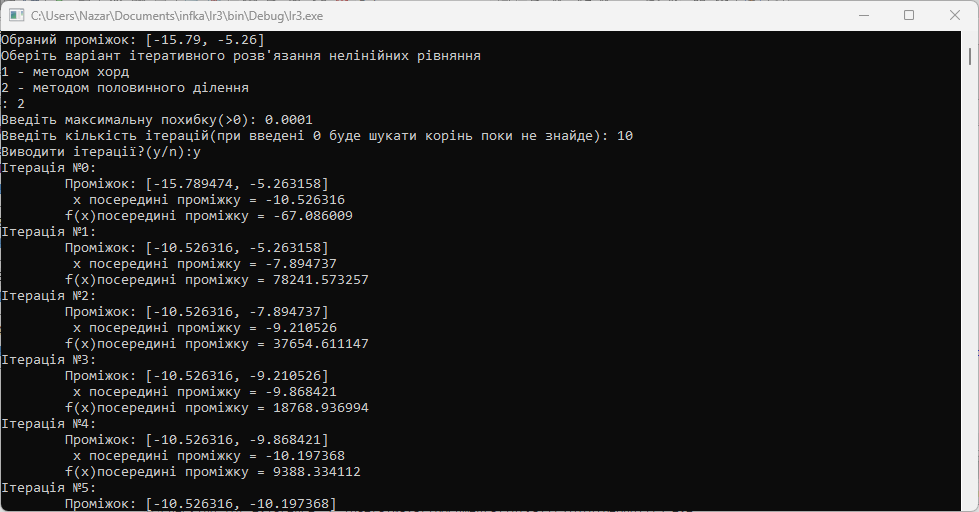
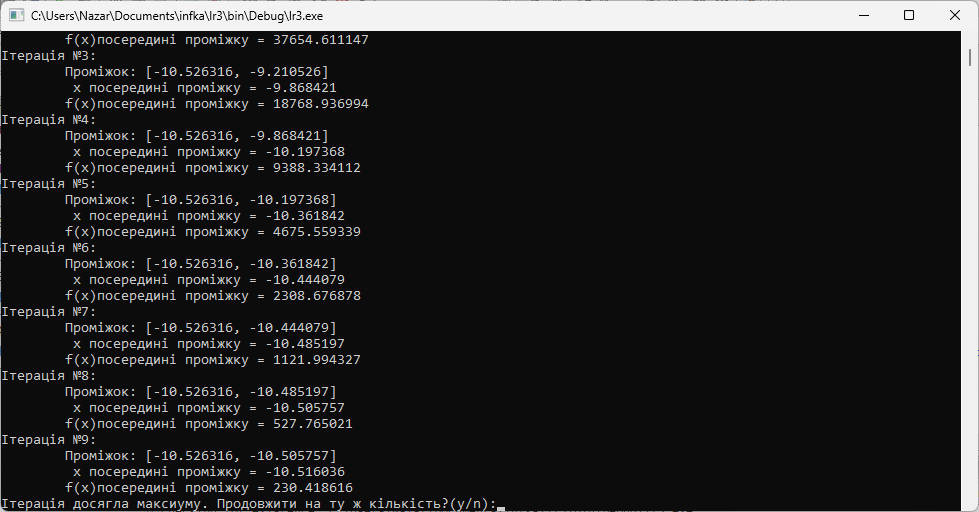
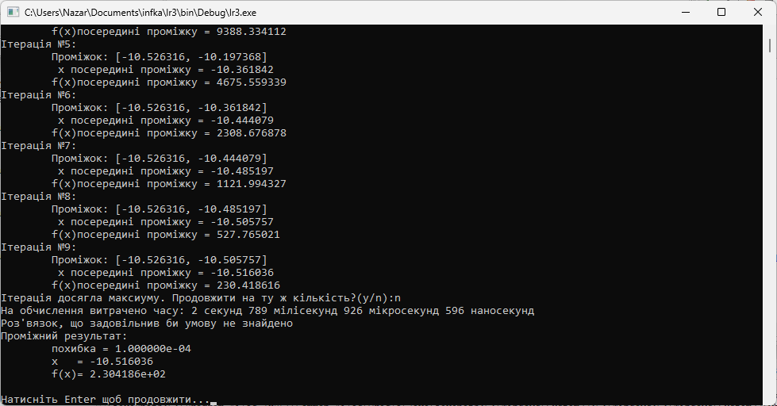
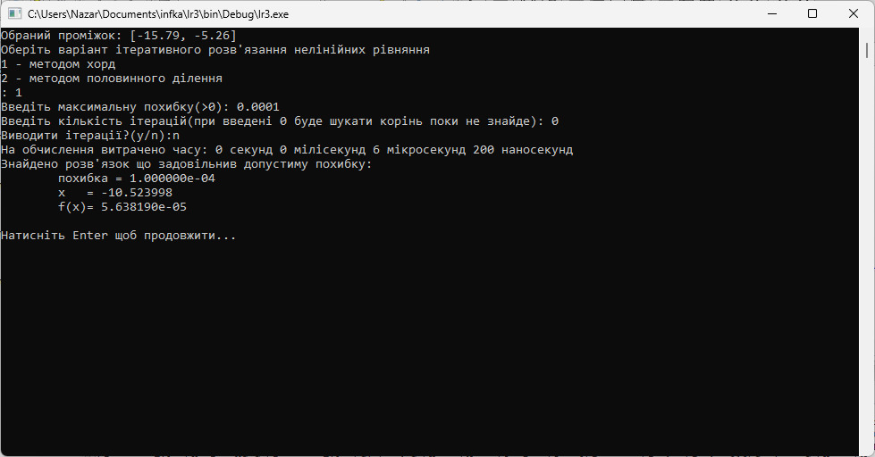

---
## 🔍 Висновки

Під час виконання лабораторної роботи № 3 було успішно розроблено та досліджено програму мовою C для розв’язання нелінійних рівнянь:

- **За Частиною 1:** Реалізовано інтерактивний текстовий інтерфейс з двома варіантами введення початкових даних ($N$ або $\Delta x$), валідацією значень та використанням динамічного виділення пам'яті (`malloc`/`free`). Побудовано таблицю табулювання функції за допомогою псевдографіки та реалізовано алгоритм автоматичного виявлення проміжків ізоляції коренів.
- **За Частиною 2:** Розроблено та застосовано чисельні ітераційні методи (метод хорд та метод половинного ділення) для знаходження коренів рівняння $f(x) = 0$ із заданою точністю `max_err` та можливістю контролю кількості ітерацій.
- **Аналіз ефективності:** Додано точний таймінг виконання обчислень. На практиці підтверджено коректність вибору проміжків ізоляції та високу швидкість збіжності реалізованих ітераційних алгоритмів.
- Отримано практичний досвід роботи з математичною бібліотекою `<math.h>`, системними функціями форматованого виводу UTF-8 в консоль Windows (`SetConsoleOutputCP`), управлінням пам'яттю та розміщенням коду і звітності в репозиторії GitHub.# lr3